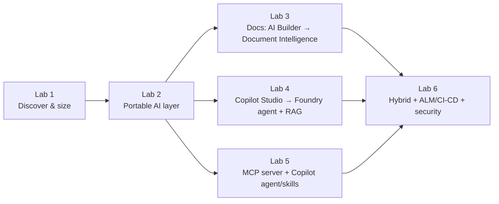

# Facilitator Guide — Intelligent Automation TTT

> **For the trainer delivering (and re-teaching) this course.** This guide gives you the
> narrative, the per-lab facilitation playbook (timing risks, failure modes, talking
> points, debrief questions), and the Train-the-Trainer framing so your attendees leave
> able to *run this course themselves*.

---

## 1. Course at a glance

| | |
|---|---|
| **Title** | From Power Platform to Azure — Intelligent Automation with GitHub Agents, Skills & MCP |
| **Length** | 1 day (~7h content), instructor-led, hands-on |
| **Delivery model** | Train-the-Trainer (attendees will re-deliver) |
| **Audience** | Trainers, solution architects, automation leads |
| **Module** | Specialization **Module B — Intelligent Automation** |
| **Outcome** | Attendees can assess a Power Platform estate, design Azure-first targets, build the reusable AI building blocks, and **teach all of it** |

### Module B coverage map

| Requirement | Where it's taught | How |
|---|---|---|
| **B.1.1** Platform delivery capability (reference architectures) | Labs 2, 3, 4, 5, 6 | Six Azure-first ref-arch patterns, each built or demoed |
| **B.1.2** Discovery & sizing | Lab 1 | The `iauto-discovery` tool, run on a real-shaped estate |
| **B.3.2** ALM for Power Platform & Azure | Lab 6 | Bicep + GitHub Actions + environments + security |
| B.2.x / B.3.1 / B.4.x (governance, ops, value) | 📋 evidence-awareness callouts | Flagged where they'd be evidenced, not busy-worked |

> **Why some requirements are "callouts" not labs:** Module B includes governance, BVA,
> and operating-model items that are **documentation/process** outcomes, not buildable
> code. We flag them with 📋 at the exact moment they'd be evidenced so trainers know the
> hook, without padding the day with paperwork. This is a deliberate, defensible scoping
> choice — say so if asked.

---

## 2. The narrative you're selling all day

Everything hangs off **one story**:

> *"A customer is mature on Power Platform but hitting ceilings — premium licensing cost,
> security/residency limits, and scale. We migrate the right workloads to Azure, keep what
> Power Platform does well, and make the AI layer **portable** so they're never locked to
> one model or cloud."*

Keep returning to it. Each lab is a chapter:



The **modular inference layer (Lab 2)** is the spine: build once, reuse in 3/4/5, swap
providers by config. If attendees remember one thing, make it this.

---

## 3. The latest-and-greatest you're demonstrating

Call these out explicitly — they're *why* this course is current:

- **GitHub Models** as a free, OpenAI-compatible inference endpoint (classroom default).
- **GitHub Copilot agents & skills** + a **custom MCP server** (Lab 5) — the
  Model Context Protocol is the interoperability story for tools/agents.
- **Azure AI Foundry** agents + **Azure AI Search** RAG (Lab 4), built on the
  **Microsoft Agent Framework** (the unified successor to Semantic Kernel + AutoGen).
- **Azure AI Document Intelligence** replacing AI Builder document models (Lab 3).
- **Entra ID + managed identity** everywhere (no keys), **Bicep** IaC, **GitHub Actions**
  with environments, **OpenTelemetry → Application Insights** telemetry, **CodeQL**.

---

## 4. Per-lab facilitation playbook

For each lab: **goal · timing risk · common failures · talking points · debrief.**

### Lab 0 — Setup (45m)
- **Goal:** everyone green on toolchain + a live GitHub Models call (Python *and* .NET).
- **Timing risk:** 🔴 highest of the day. Mitigate by mandating Codespaces and sending
  [prerequisites.md](prerequisites.md) in advance.
- **Common failures:**
  - PAT missing the **Models** scope → 401/403. Re-issue a fine-grained token.
  - Wrong Python (`3.13/3.14`) → SDK wheel errors. Force `uv venv --python 3.12`.
  - `dotnet test IAuto.Inference.sln` → `MSB1009`. It's **`.slnx`**.
- **Talking points:** "We're proving the spine before we build on it." "Free in class,
  Entra-secured in prod."
- **Debrief:** *What did the same `.env` contract buy us across two languages?*

### Lab 1 — Discovery & sizing (45m) · **B.1.2**
- **Goal:** generate a defensible migration report; explain one recommendation out loud.
- **Timing risk:** 🟢 low — tool is offline and fast.
- **Common failures:** CSV column typos; unknown `automation_type` (extend the enum).
- **Talking points:** "Transparent rules beat a black box in front of a customer." Trace
  `effort_for()` live. Stress the cost figures are **bands**, refined later with pricing.
- **Debrief:** *Where would the deterministic rules mislead you, and how would you catch
  it?* (Answer: edge automations; the per-type test + human review.)

### Lab 2 — Modular inference (60m) · **B.1.1**
- **Goal:** run identical code on GitHub Models, then **swap to Azure OpenAI via env only**.
- **Timing risk:** 🟡 amber — the Azure OpenAI swap needs a deployed model + an RBAC grant.
  Pre-provision a shared resource if your room lacks subscriptions.
- **Common failures:**
  - Forgot the **Cognitive Services OpenAI User** role → 403 on Entra auth.
  - Endpoint/deployment name mismatch.
- **Talking points:** "No secret was pasted." `DefaultAzureCredential` = `az login` locally,
  managed identity in Azure. One chokepoint = instrument telemetry once.
- **Debrief:** *What breaks if a team hard-wires one SDK instead?* (Lock-in, re-test cost,
  no portable telemetry.)

### Lab 3 — Document processing (60m) · **B.1.1**
- **Goal:** AI Builder doc model → **Azure AI Document Intelligence + .NET Functions**,
  inference via the shared layer.
- **Timing risk:** 🟡 amber — first Azure deploy of the day; Functions cold start.
- **Common failures:** missing role on the Document Intelligence resource; sample file path.
- **Talking points:** human-in-the-loop, idempotency, telemetry on extraction confidence.
- **Debrief:** *What's the migration risk vs AI Builder, and how do you de-risk?*

### Lab 4 — Foundry agent + RAG (75m) · **B.1.1**
- **Goal:** Copilot Studio bot → **Azure AI Foundry agent** grounded with **Azure AI
  Search** (Python, Microsoft Agent Framework).
- **Timing risk:** 🔴 longest; Search index build + grounding config.
- **Common failures:** empty/garbage index; agent not wired to the retrieval tool; Entra
  scope on Search.
- **Talking points:** RAG quality = retrieval quality. Show a grounded vs ungrounded answer.
- **Debrief:** *How do you evaluate this agent before production?* (eval sets, groundedness.)

### Lab 5 — MCP server + Copilot agent/skills (75m, capstone) · **B.1.1**
- **Goal:** build a **custom MCP server** exposing automation tools, plus a **Copilot
  agent + skills**; tools call the shared inference layer and the pricing API.
- **Timing risk:** 🟡 amber — MCP wiring is new to most; budget for "aha" friction.
- **Common failures:** server transport/registration; tool schema mismatches.
- **Talking points:** MCP = the USB-C of agent tooling — write a capability once, any
  MCP-aware client uses it. This is the interoperability headline.
- **Debrief:** *What in your org should become an MCP server first?*

### Lab 6 — Hybrid + ALM/CI-CD + security (45m, flex) · **B.3.2**
- **Goal:** hybrid integration (Logic Apps/APIM) + **Bicep + GitHub Actions environments**
  + security gates (CodeQL, secret scanning, least-privilege).
- **Timing risk:** 🔴 if run hands-on late in the day. **This is your flex block** — run as
  a guided demo if behind.
- **Common failures:** OIDC federation to Azure not set up; environment protection rules.
- **Talking points:** IaC + pipelines **are** the ALM evidence (B.3.2). Promote dev→test→prod
  with approvals.
- **Debrief:** *What's the smallest ALM setup that's still production-credible?*

---

## 5. Teaching the evidence-awareness philosophy

The specialization is evidence-assessed. We **don't** stop to collect screenshots all day —
that's not learning. Instead, every lab carries a 📋 callout at the exact point where the
artifact you just produced **is** the evidence (e.g. Lab 1's `report.md` for B.1.2). Teach
attendees to recognise these hooks so, when *they* deliver a real engagement, capturing
evidence is a 10-second byproduct, not a separate workstream.

> Say this verbatim if useful: *"Generating the artifact is the work. Saving it is the only
> extra step. We'll point at every hook; you decide when to press record."*

---

## 6. Common cross-lab failure modes (quick reference)

| Symptom | Cause | Fix |
|---|---|---|
| 401/403 on GitHub Models | PAT lacks **Models** scope | Re-issue fine-grained token, Models: read |
| 403 on Azure OpenAI/Foundry/Search | Missing data-plane RBAC | Assign the right *Data*/*User* role to your identity |
| Python wheel build errors | Python 3.13/3.14 | `uv venv --python 3.12` |
| `.slnx` not found / `MSB1009` | Used `.sln` | Use `IAuto.Inference.slnx` |
| Bicep deploy fails on apiVersion | Stale version | Use the pinned versions in `infra/bicep` |
| Functions 500 on first call | Cold start / missing app setting | Retry; verify `AddModularInference()` env wired |

---

## 7. Instructor solutions

A protected **`solutions`** branch (or the merged feature branches) holds reference
implementations for every lab. Keep it checked out in a second worktree for quick lookups,
but **don't** show it until learners have struggled productively — the struggle is the
learning. <a id="instructor-solutions"></a>

---

## 8. TTT debrief (last 15 minutes)

Run this so attendees leave ready to **re-teach**:

1. **Round-robin:** each attendee names the lab they'd find hardest to teach and why.
2. **Pacing:** agree where *they* would cut if behind (answer should be: depth in 3–6,
   never 0–2).
3. **Localisation:** what would they change for their audience/region (SKUs, regions,
   language)?
4. **Narrative check:** can each attendee state the one-sentence migration story?
5. **Action:** everyone leaves with the repo, the [agenda](agenda.md), this guide, and a
   date to dry-run a lab with a colleague.

---

## 9. Reset between cohorts

```bash
# tear down all Azure resources to stop spend
az group delete -n <your-rg> --yes --no-wait
# revoke the throwaway GitHub Models PAT
# delete per-learner Codespaces
```

> ✅ You're ready to deliver. Start the day on [the agenda](agenda.md) and Lab 0.
