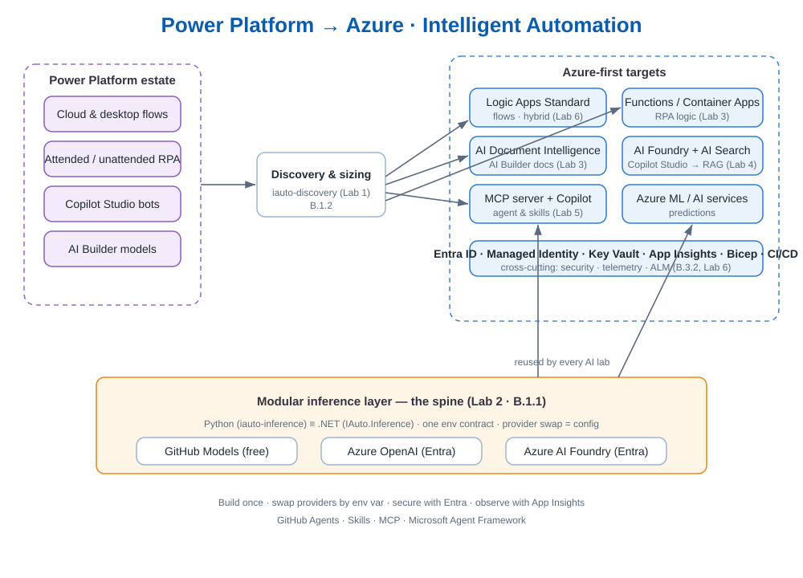

<!-- _class: lead -->

# From Power Platform to Azure
## Intelligent Automation with GitHub Agents, Skills & MCP

**1-Day Train-the-Trainer**
Specialization · Module B — Intelligent Automation

> Build once. Swap providers by config. Migrate with confidence.

---

## Why we're here

- Customers are **mature on Power Platform** but hit ceilings:
  - 💸 premium licensing cost
  - 🔐 security / data residency limits
  - 📈 scale & integration
- We **migrate the right workloads to Azure**, keep what Power Platform does well…
- …and make the **AI layer portable** — never locked to one model or cloud.

> One sentence to remember all day: **migrate the right things, keep the rest, stay portable.**

---

## Train-the-Trainer: how today works

- You'll **build every lab hands-on**…
- …**and** learn to **re-teach** it: trainer notes, timing risks, failure modes, debriefs.
- Each lab has a hard **"definition of green"** — your pacing gate.
- 📋 **Evidence-awareness** callouts show where output *is* the assessment evidence —
  without stopping to do paperwork.

---

## Module B — what we cover

| Requirement | Lab | |
|---|---|---|
| **B.1.1** Platform delivery (ref-architectures) | 2,3,4,5,6 | built / demoed |
| **B.1.2** Discovery & sizing | 1 | the tool |
| **B.3.2** ALM (Power Platform & Azure) | 6 | Bicep + Actions |
| B.2.x / B.3.1 / B.4.x | — | 📋 evidence-awareness callouts |

<span class="small">Governance/BVA/ops items are **documentation outcomes**, flagged where they'd be evidenced — a deliberate scoping choice.</span>

---

## The day at a glance

1. **Lab 0** — Setup & modular-inference smoke test
2. **Lab 1** — Discovery, sizing & migration decisioning · *B.1.2*
3. **Lab 2** — The modular inference layer (Python + .NET) · *spine*
4. **Lab 3** — Document processing → Document Intelligence + Functions
5. **Lab 4** — Copilot Studio → Azure AI Foundry agent + RAG
6. **Lab 5** — Custom MCP server + Copilot agent + skills *(capstone)*
7. **Lab 6** — Hybrid integration + ALM/CI-CD + security · *B.3.2*

---

## Architecture tour



- **Discovery** turns an estate into Azure-first targets.
- **Modular inference** is the **spine** every AI lab reuses.
- Providers swap by **one env var**: GitHub Models → Azure OpenAI → Azure AI Foundry.
- **Entra ID + managed identity** everywhere — no keys.
- Telemetry → **Application Insights** at one chokepoint.

---

## The spine: modular inference

```text
INFERENCE_PROVIDER = github | azure_openai | foundry
```

- **GitHub Models** — free, OpenAI-compatible → classroom default
- **Azure OpenAI** — key *or* Entra (no key)
- **Azure AI Foundry** — key *or* Entra

> Same code in **Python** *and* **.NET**. Identical env contract. **Provider swap = config.**

---

## Latest & greatest you'll touch

- 🆓 **GitHub Models** inference endpoint
- 🤖 **GitHub Copilot agents & skills** + a **custom MCP server** (the "USB-C" of agent tools)
- 🧠 **Azure AI Foundry** agents on the **Microsoft Agent Framework** (SK + AutoGen successor)
- 🔎 **Azure AI Search** RAG grounding
- 📄 **Azure AI Document Intelligence**
- 🏗️ **Bicep**, **GitHub Actions** environments, **OpenTelemetry**, **CodeQL**

---

## Lab 1 — Discovery & sizing · B.1.2

- Feed a real-shaped **inventory** (CSV/JSON) into `iauto-discovery`.
- Get **Azure targets + ref-arch**, **sizing tier**, **t-shirt effort**, **ROI**.
- Rules are **transparent** — defend every recommendation to a customer.
- Optional **LLM executive narrative** via the same modular layer.

> 📋 The generated `report.md` **is** your discovery & sizing evidence.

---

## Lab 2 — Modular inference · B.1.1

- Read the small Python + .NET layers.
- Run a live call on **GitHub Models**.
- **Swap to Azure OpenAI with Entra (no key)** — *same code*.
- (Stretch) Foundry + streaming.

> The payoff: build the AI building block **once**, reuse it in Labs 3–6.

---

## Labs 3–5 — build the building blocks

- **Lab 3:** AI Builder docs → **Document Intelligence + .NET Functions** (HITL, telemetry).
- **Lab 4:** Copilot Studio bot → **Foundry agent grounded with AI Search** (Python).
- **Lab 5 (capstone):** a **custom MCP server** + **Copilot agent & skills**; tools call the
  shared inference layer **and** the Azure pricing API.

> Each reuses the spine. Each maps to a numbered Module B reference architecture.

---

## Lab 6 — Hybrid + ALM/CI-CD + security · B.3.2

- Hybrid integration: **Logic Apps Standard / APIM** bridging on-prem.
- **Bicep + GitHub Actions** with **dev→test→prod environments** & approvals.
- Security gates: **CodeQL**, secret scanning, **least-privilege** managed identities.

> 📋 Your IaC + pipelines **are** the ALM evidence.

---

## Evidence-awareness — the philosophy

> **Generating the artifact is the work. Saving it is the only extra step.**

- We **don't** stop all day to screenshot.
- Each lab flags 📋 the exact moment its output becomes evidence.
- You decide when to press record in a real engagement.

---

<!-- _class: lead -->

## Let's begin

**Lab 0 — Setup & modular-inference smoke test**

`labs/lab-0-setup/README.md`

> Get everyone *green* before we build. The spine first. 🟢
