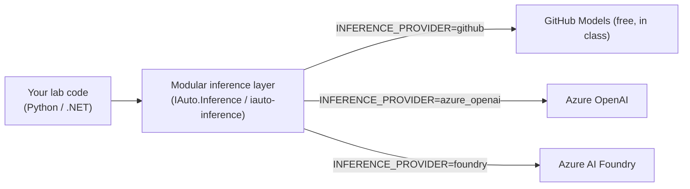

# Lab 0 — Setup & Modular-Inference Smoke Test

> **Duration:** 45 min · **Module B mapping:** prerequisite for B.1.1 / B.1.2
> **Goal:** Every learner ends this lab with a working toolchain and a *green* inference
> call from **both** Python and .NET against **GitHub Models** (free) — proving the
> modular inference backbone works before we build anything on top of it.

---

## Why this lab matters (trainer note)

The entire course rests on one idea: **write inference code once, swap the provider with
an environment variable.** If the smoke test is green here, every later lab (document
processing, Foundry agents, the MCP server) "just works" on the free GitHub Models
endpoint in class and on Azure OpenAI / Azure AI Foundry in production — with **no code
change**. Spend the time to get all learners green here; it pays back all day.



---

## 0.1 Prerequisites checklist

You can run this lab three ways. **Codespaces / Dev Container is strongly recommended**
for the classroom — it pins every tool version for you.

| Path | What you need |
|---|---|
| **GitHub Codespaces** (recommended) | A browser + this repo. Click **Code → Codespaces → Create**. |
| **VS Code Dev Container** | Docker Desktop + VS Code + *Dev Containers* extension → *Reopen in Container*. |
| **Local** | See the manual tool list below. |

### Manual local tooling (only if not using the container)

| Tool | Min version | Check | Install |
|---|---|---|---|
| **Python** | 3.12 | `python --version` | [python.org](https://www.python.org/downloads/) |
| **uv** | latest | `uv --version` | `pip install uv` or [astral.sh/uv](https://docs.astral.sh/uv/) |
| **.NET SDK** | 9.0 | `dotnet --version` | [dot.net](https://dotnet.microsoft.com/download) |
| **Git** | 2.40+ | `git --version` | [git-scm.com](https://git-scm.com/) |
| **GitHub CLI** | latest | `gh --version` | [cli.github.com](https://cli.github.com/) |
| **Azure CLI** | latest | `az version` | [aka.ms/azcli](https://learn.microsoft.com/cli/azure/install-azure-cli) |

> 💡 Python 3.14 has no wheel yet for some Azure AI SDKs. **We standardise on Python 3.12
> via `uv`** across every lab: `uv venv --python 3.12`.

---

## 0.2 Get an inference credential (free path)

We default to **GitHub Models**, which is free with your GitHub account — perfect for a
classroom.

1. Create a **fine-grained Personal Access Token** with the **Models** permission:
   - GitHub → *Settings → Developer settings → Personal access tokens → Fine-grained tokens → Generate new token*.
   - Under **Permissions → Account permissions → Models**, set **Read-only**.
   - Copy the token (starts with `github_pat_…`).
2. In Codespaces, a `GITHUB_TOKEN` is often already present, but it may **not** carry the
   Models scope — use your fine-grained token to be safe.

> 🔐 **Never commit tokens.** We use `.env` files that are git-ignored. The Azure-backed
> providers later use **Entra ID + managed identity** and need no key at all.

---

## 0.3 The shared environment contract

Both the Python and .NET layers read the **same** variables. Copy the example file and
fill in just the GitHub block for now:

```bash
# from the repo root
cp src/inference/python/.env.example src/inference/python/.env
```

```ini
# src/inference/python/.env  (and the identical .NET contract)
INFERENCE_PROVIDER=github

GITHUB_TOKEN=github_pat_xxxxxxxxxxxxxxxxx
GITHUB_MODELS_ENDPOINT=https://models.github.ai/inference
GITHUB_MODELS_MODEL=openai/gpt-4o-mini

INFERENCE_TIMEOUT=60
INFERENCE_MAX_RETRIES=3
```

| Variable | Meaning | Default |
|---|---|---|
| `INFERENCE_PROVIDER` | `github` \| `azure_openai` \| `foundry` | `github` |
| `GITHUB_TOKEN` | PAT with **Models** read | — |
| `GITHUB_MODELS_ENDPOINT` | GitHub Models inference endpoint | `https://models.github.ai/inference` |
| `GITHUB_MODELS_MODEL` | Model id | `openai/gpt-4o-mini` |
| `INFERENCE_TIMEOUT` | Per-request timeout (s) | `60` |
| `INFERENCE_MAX_RETRIES` | Transient-retry budget | `3` |

The Azure OpenAI and Foundry blocks are in the same `.env.example` — we'll switch to them
in **Lab 2**.

---

## 0.4 Smoke test — Python 🐍

```bash
cd src/inference/python
uv venv --python 3.12
uv pip install -e ".[dev]"
# run the test suite (offline; uses a stub client)
uv run pytest -q
```

Now a *live* call against GitHub Models:

```bash
uv run python -c "from iauto_inference import InferenceClient; print(InferenceClient.from_env().complete('Reply with the single word: ready').text)"
```

✅ **Expected:** the model prints something like `ready`. If you see a config error, your
`.env` isn't being found — run from `src/inference/python` or `export`/`set` the vars.

---

## 0.5 Smoke test — .NET 🟦

```bash
cd src/inference/dotnet
dotnet build
dotnet test IAuto.Inference.slnx
```

A live call (a tiny console snippet ships in the .NET README):

```bash
# from src/inference/dotnet
dotnet run --project samples/SmokeTest    # if present, else see README snippet
```

✅ **Expected:** all tests pass and the live call returns a short completion.

> If `dotnet test IAuto.Inference.sln` fails with `MSB1009`, note the solution is the new
> XML format: use **`IAuto.Inference.slnx`**.

---

## 0.6 Verify your Azure access (for later labs)

Labs 3–6 deploy to Azure. Confirm you can sign in and see a subscription now so there are
no surprises after lunch:

```bash
az login
az account show -o table
az account list -o table
```

You need **Contributor** (or Owner) on a resource group you can deploy into. The free
Azure account or an MSDN/Visual Studio subscription is enough — every lab uses
free/consumption SKUs.

> 💡 No Azure subscription? You can still complete Labs 0–2 fully on GitHub Models, and
> *read along* on the Azure deploys. Pair up with someone who has a subscription.

---

## 0.7 Done — definition of "green"

- [ ] Toolchain versions verified (or container opened).
- [ ] `.env` created with a working `GITHUB_TOKEN` (Models scope).
- [ ] Python: `pytest` green **and** live `complete()` returns text.
- [ ] .NET: `dotnet test` green **and** live call returns text.
- [ ] `az account show` lists a subscription you can deploy into.

> 📋 **Evidence awareness:** In the specialization, your environment readiness +
> a successful inference call are exactly the kind of "capability proven" evidence an
> assessor looks for (B.1.1). Screenshot the two green smoke tests if you want the
> artifact — generating them is the real work; capturing them is the only extra step.

➡️ **Next:** [Lab 1 — Discovery & Sizing](../lab-1-discovery-sizing/README.md)
