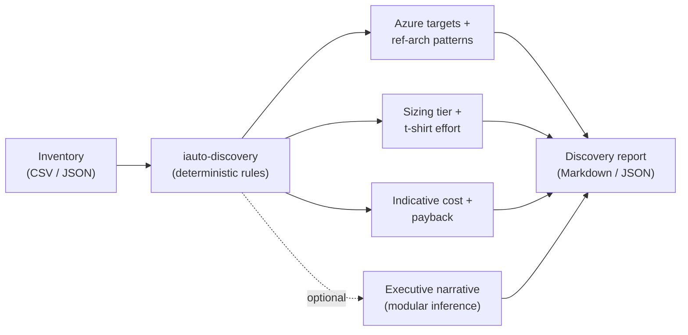

# Lab 1 — Discovery, Sizing & Migration Decisioning

> **Duration:** 45 min · **Module B mapping:** **B.1.2** (Discovery & sizing) + entry to
> **B.1.1** (platform delivery capability)
> **Goal:** Take a messy Power Platform estate, turn it into a **sized, costed,
> Azure-first migration plan**, and learn how to defend every recommendation.

---

## Why this lab matters (trainer note)

Customers don't start with "build me an Azure Function." They start with *"we have 200
flows, some desktop bots, a Copilot Studio bot and a few AI Builder models — what do we do
with them?"* **Discovery & sizing is the consulting skill** that turns that into a plan.
We use a small, transparent tool (`iauto-discovery`) so the *rules are explainable* — no
black box. Then we layer an optional LLM narrative on top using the same modular inference
layer from Lab 0.



---

## 1.1 The scenario

**Contoso Logistics** runs on Power Platform and wants to move to Azure to cut premium
licensing, harden security, and scale. They hand you a spreadsheet. Your job: a defensible
migration recommendation by end of day.

A representative inventory ships with the tool: [`samples/inventory.csv`](../../tools/discovery/samples/inventory.csv).

| name | automation_type | runs/day | avg_min | conn | complexity | sensitivity | on-prem | premium |
|---|---|---|---|---|---|---|---|---|
| Invoice intake bot | ai_builder_doc | 40 | 3 | 4 | medium | high | ✓ | ✓ |
| Nightly ERP sync | unattended_rpa | 1 | 90 | 6 | high | medium | ✓ | ✓ |
| Sales assistant chatbot | copilot_studio | 200 | 1 | 5 | high | medium | ✗ | ✓ |
| … | … | | | | | | | |

---

## 1.2 Run the tool

```bash
cd tools/discovery
uv venv --python 3.12
uv pip install -e ".[dev]"

# Markdown report to the console
uv run iauto-discover samples/inventory.csv

# Save both a human report and machine JSON
uv run iauto-discover samples/inventory.csv --out report.md
uv run iauto-discover samples/inventory.csv --json --out report.json
```

Read the **Portfolio summary** first (totals, Azure run cost, premium avoided, one-off
migration cost, payback), then the **per-automation table** (each automation → Azure
target, reference-architecture pattern, sizing tier, effort, $/mo).

---

## 1.3 Understand the rules (so you can defend them)

Open [`tools/discovery/iauto_discovery/rules.py`](../../tools/discovery/iauto_discovery/rules.py).
Everything is deterministic and documented:

- **Target mapping** — each `automation_type` maps to an **Azure-first** target and a
  numbered reference architecture:

  | Power Platform | Azure target | Ref-arch |
  |---|---|---|
  | Cloud flow | Logic Apps Standard | Hybrid integration |
  | Attended RPA | Logic Apps Standard + Functions (UI on hosted machines) | Attended RPA |
  | Unattended RPA | Container Apps Jobs / Functions | Unattended RPA |
  | Copilot Studio | Azure AI Foundry agent + AI Search (RAG) | Copilot Studio + RAG |
  | AI Builder (doc) | AI Document Intelligence + Functions | Document processing |
  | AI Builder (predict) | Azure ML / Azure AI services | Event-driven AI |

- **Sizing tier** from monthly execution minutes (`runs_per_day × avg_minutes ×
  working_days`): `< 2,000` → small, `< 20,000` → medium, else large.
- **Effort (S/M/L/XL)** scores complexity, then escalates for ≥5 connectors, on-prem
  coupling, high sensitivity, and heavier targets.
- **Security** recommendations scale with data sensitivity and on-prem coupling (managed
  identity → private endpoints → Defender / CMK).

> 🧠 **Exercise:** Change `Nightly ERP sync` to `complexity: low` and `connectors: 2`.
> Re-run. Watch the effort drop from **XL** to **M**. *Why?* Trace it through
> `effort_for()`. This is how you sanity-check the tool in front of a customer.

---

## 1.4 Tune the economics

The default costs are documented **placeholders**. Real engagements use the customer's
rates. Create `rates.json`:

```json
{
  "working_days_per_month": 21,
  "azure_cost_small": 20, "azure_cost_medium": 90, "azure_cost_large": 350,
  "pp_premium_monthly": 20,
  "effort_cost_s": 2500, "effort_cost_m": 7000, "effort_cost_l": 18000, "effort_cost_xl": 40000
}
```

```bash
uv run iauto-discover samples/inventory.csv --assumptions rates.json --out report.md
```

> ⚠️ The figures are **indicative bands for teaching**. Refine them with the **Azure
> pricing** tooling (the MCP server / `az` pricing APIs) against the real target SKUs
> before you quote a customer. We do exactly that in Lab 5.

---

## 1.5 Add an executive narrative (modular inference)

The same provider-swap you proved in Lab 0 now powers an LLM summary — no new SDK:

```bash
# install the optional 'ai' extra (pulls the shared inference layer)
uv pip install -e ".[dev,ai]"

# ensure a provider is configured (.env or environment)
cp .env.example .env   # fill in GITHUB_TOKEN

uv run iauto-discover samples/inventory.csv --narrative --out report.md
```

The narrative appears under **## Executive narrative**. Switch
`INFERENCE_PROVIDER=azure_openai` (Lab 2) and the *same command* runs on Azure OpenAI.

> 💡 If the `ai` extra or a provider isn't configured, the tool prints a friendly warning
> and still produces the deterministic report. The LLM is **icing, not load-bearing** —
> a deliberate design choice so discovery never blocks on a model.

---

## 1.6 Bring your own estate (optional stretch)

Export your real tenant inventory and feed it in:

- **Power Platform admin / CoE Starter Kit** can export flows, desktop flows, and apps.
- Map columns to the [inventory schema](../../tools/discovery/README.md#inventory-schema)
  (CSV or JSON). Unknown automation types? Extend the `AutomationType` enum and add a rule
  — the tests will tell you if you missed a mapping (`test_every_automation_type_has_a_target`).

---

## 1.7 Done — definition of "green"

- [ ] Generated a Markdown **and** JSON report from the sample inventory.
- [ ] Explained, out loud, why one automation got its tier and effort.
- [ ] Re-ran with custom `rates.json` and saw the ROI change.
- [ ] (Stretch) Produced an LLM executive narrative via the modular layer.

> 📋 **Evidence awareness:** the generated `report.md` (plus the source inventory and your
> `rates.json`) **is** the discovery & sizing evidence for **B.1.2**. Generating it is the
> work; saving the file is the only extra step an assessor expects.

➡️ **Next:** [Lab 2 — The Modular Inference Layer](../lab-2-modular-inference/README.md)
