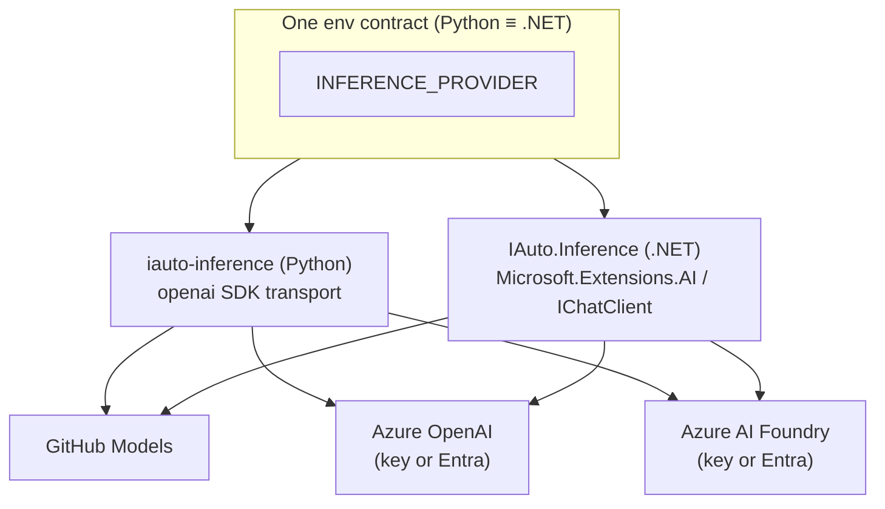

# Lab 2 — The Modular Inference Layer (Python + .NET)

> **Duration:** 60 min · **Module B mapping:** **B.1.1** (reusable platform capability) ·
> backbone for Labs 3–6
> **Goal:** Understand and exercise the **one inference abstraction** the whole course
> reuses. Run the *same code* against GitHub Models, then **swap to Azure OpenAI and Azure
> AI Foundry with only environment variables.**

---

## Why this lab matters (trainer note)

This is the architectural heart of the course. Most teams hard-wire one model SDK and pay
for it later when they migrate clouds or chase a cheaper model. We build a **thin,
provider-agnostic layer** in both languages with an **identical environment contract**, so:

- In class we run **free** on GitHub Models.
- In production we flip to **Azure OpenAI** or **Azure AI Foundry** — **no code change**.
- Azure providers authenticate with **Entra ID + managed identity** (no keys to leak).



---

## 2.1 The design in one minute

- **Single transport.** Python uses the `openai` SDK for *all three* providers (they're
  OpenAI-compatible). .NET uses `Microsoft.Extensions.AI`'s `IChatClient` as the common
  type, built from `OpenAIClient` / `AzureOpenAIClient`.
- **One config object.** `InferenceSettings` (Python) / `InferenceOptions` (.NET) read the
  **same** environment variables and validate them.
- **Provider swap = env var.** `INFERENCE_PROVIDER=github|azure_openai|foundry`.
- **Entra-first auth.** If an Azure key is omitted, the layer uses
  `DefaultAzureCredential` (managed identity in Azure, your `az login` locally).

### The shared contract (memorise this table)

| Variable | github | azure_openai | foundry |
|---|---|---|---|
| `INFERENCE_PROVIDER` | `github` | `azure_openai` | `foundry` |
| token / key | `GITHUB_TOKEN` | `AZURE_OPENAI_API_KEY` *(optional → Entra)* | `AZURE_AI_FOUNDRY_API_KEY` *(optional → Entra)* |
| endpoint | `GITHUB_MODELS_ENDPOINT` | `AZURE_OPENAI_ENDPOINT` | `AZURE_AI_FOUNDRY_ENDPOINT` |
| model id | `GITHUB_MODELS_MODEL` | `AZURE_OPENAI_DEPLOYMENT` | `AZURE_AI_FOUNDRY_MODEL` |
| extra | — | `AZURE_OPENAI_API_VERSION` (def `2024-10-21`) | — |

Shared tuning: `INFERENCE_TIMEOUT` (60), `INFERENCE_MAX_RETRIES` (3).
Entra scope used for Azure: `https://cognitiveservices.azure.com/.default`.

---

## 2.2 Read the Python layer 🐍

Open these four files (they're small on purpose):

| File | What to look for |
|---|---|
| [`settings.py`](../../src/inference/python/iauto_inference/settings.py) | The env contract + `default_model()` provider switch |
| [`providers.py`](../../src/inference/python/iauto_inference/providers.py) | How one `openai` client is built per provider (Entra token provider for Azure) |
| [`client.py`](../../src/inference/python/iauto_inference/client.py) | The `InferenceClient` facade: `complete`, `acomplete`, `stream`, `astream` |
| [`errors.py`](../../src/inference/python/iauto_inference/errors.py) | Typed errors so callers fail loudly and clearly |

Run it:

```bash
cd src/inference/python
uv venv --python 3.12
uv pip install -e ".[dev]"
uv run pytest -q                      # offline tests (stubbed client)

uv run python -c "from iauto_inference import InferenceClient; print(InferenceClient.from_env().complete('Name one Azure service for unattended automation.').text)"
```

> 🧠 **Exercise:** Use streaming. Write a 3-line script that prints tokens as they arrive:
> ```python
> from iauto_inference import InferenceClient
> for tok in InferenceClient.from_env().stream("Count to five."):
>     print(tok, end="", flush=True)
> ```

---

## 2.3 Read the .NET layer 🟦

| File | What to look for |
|---|---|
| [`InferenceOptions.cs`](../../src/inference/dotnet/IAuto.Inference/InferenceOptions.cs) | The same env contract as a POCO + `FromEnvironment()` + `Validate()` |
| [`ChatClientFactory.cs`](../../src/inference/dotnet/IAuto.Inference/ChatClientFactory.cs) | Builds a provider-agnostic `IChatClient` for each provider |
| [`EntraBearerPolicy.cs`](../../src/inference/dotnet/IAuto.Inference/EntraBearerPolicy.cs) | Custom pipeline policy adding an Entra bearer token for Foundry |
| [`ServiceCollectionExtensions.cs`](../../src/inference/dotnet/IAuto.Inference/ServiceCollectionExtensions.cs) | `AddModularInference()` for DI in Functions/ASP.NET |

Run it:

```bash
cd src/inference/dotnet
dotnet build
dotnet test IAuto.Inference.slnx
```

Minimal use in code:

```csharp
using IAuto.Inference;

IChatClient chat = ChatClientFactory.CreateFromEnvironment();
string answer = await chat.CompleteTextAsync(
    "Name one Azure service for document processing.");
Console.WriteLine(answer);
```

Or via dependency injection (this is how Labs 3 & 6 wire it):

```csharp
builder.Services.AddModularInference();          // reads the env contract
// then inject IChatClient anywhere
```

---

## 2.4 Provider swap #1 — Azure OpenAI

Now the payoff. **Without touching code**, point the layer at Azure OpenAI.

1. Create (or reuse) an Azure OpenAI resource and deploy a chat model, e.g. `gpt-4o-mini`:
   ```bash
   az cognitiveservices account create -n my-aoai -g my-rg -l swedencentral \
     --kind OpenAI --sku S0 --yes
   az cognitiveservices account deployment create -n my-aoai -g my-rg \
     --deployment-name gpt-4o-mini --model-name gpt-4o-mini \
     --model-version "2024-07-18" --model-format OpenAI --sku-capacity 10 --sku-name Standard
   ```
2. Grant yourself **Cognitive Services OpenAI User** on the resource (Entra auth, no key):
   ```bash
   az role assignment create --assignee <your-object-id> \
     --role "Cognitive Services OpenAI User" \
     --scope $(az cognitiveservices account show -n my-aoai -g my-rg --query id -o tsv)
   ```
3. Update `.env` — **leave the API key blank to use Entra**:
   ```ini
   INFERENCE_PROVIDER=azure_openai
   AZURE_OPENAI_ENDPOINT=https://my-aoai.openai.azure.com
   AZURE_OPENAI_DEPLOYMENT=gpt-4o-mini
   # AZURE_OPENAI_API_KEY=        # omit → DefaultAzureCredential
   ```
4. Re-run the **exact same** Python/.NET commands from 2.2 / 2.3. ✅ Same output, new
   provider.

> 🔐 Notice you pasted **no secret**. `DefaultAzureCredential` used your `az login` locally
> and would use a **managed identity** in Azure. This is the pattern every later lab uses.

---

## 2.5 Provider swap #2 — Azure AI Foundry

```ini
INFERENCE_PROVIDER=foundry
AZURE_AI_FOUNDRY_ENDPOINT=https://<resource>.services.ai.azure.com/models
AZURE_AI_FOUNDRY_MODEL=gpt-4o-mini
# AZURE_AI_FOUNDRY_API_KEY=     # omit → Entra (EntraBearerPolicy in .NET)
```

Re-run. Same code, third provider. This is the model you'll ground with RAG in **Lab 4**.

---

## 2.6 How retries, timeouts & telemetry fit

- **Timeouts/retries** come straight from `INFERENCE_TIMEOUT` / `INFERENCE_MAX_RETRIES`
  and are honoured by the underlying SDK transport.
- **Telemetry:** because everything funnels through one client, you instrument **once**.
  Labs 3–6 add OpenTelemetry → Application Insights at this single chokepoint, so every AI
  call is traced with latency + token counts.

---

## 2.7 Done — definition of "green"

- [ ] Read both layers and can explain "provider swap = env var".
- [ ] Ran a live completion on **GitHub Models** (Python **and** .NET).
- [ ] Swapped to **Azure OpenAI** with **Entra auth (no key)** and re-ran unchanged code.
- [ ] (Stretch) Swapped to **Azure AI Foundry**.
- [ ] (Stretch) Streamed tokens.

> 📋 **Evidence awareness:** a single screen recording showing the *same* code returning
> results on two providers is compelling **B.1.1** capability evidence ("reusable,
> portable platform component"). Generating the working layer is the work; recording the
> swap is the only extra step.

➡️ **Next:** [Lab 3 — Document Processing Migration](../lab-3-document-processing/README.md)
