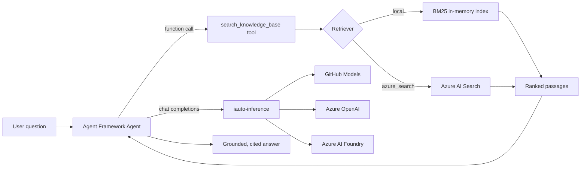

# Lab 4 — Copilot Studio → Azure AI Foundry agent + RAG

> **Duration:** ~75 minutes · **Module B:** **B.1.1** (platform delivery capability) ·
> **Migration target:** a Copilot Studio + knowledge-base bot → a code-first **Azure AI
> Foundry** agent on **Microsoft Agent Framework**, with **RAG** over **Azure AI Search**.

In this lab you migrate a classic **Copilot Studio** knowledge bot — a system prompt, a
knowledge source, and topic/tool triggers — into a portable, testable Python agent. It runs
**free and offline first** (local BM25 index + GitHub Models), then upgrades to **Azure AI
Search + Azure OpenAI / Azure AI Foundry** by *configuration only*, on the shared
`iauto-inference` layer you built in Lab 2.

## Objectives

By the end of this lab you can:

1. Explain how a Copilot Studio bot maps onto **Microsoft Agent Framework** primitives
   (agent brain, knowledge source, tool triggers, grounded citations).
2. Run a **grounded RAG agent** with **zero Azure** using a custom **Okapi BM25** index and
   free **GitHub Models**.
3. Demonstrate **tool / function-calling**: the model decides when to call
   `search_knowledge_base` and cites the passages it used.
4. Upgrade the *same code* to **Azure AI Search** by flipping `RETRIEVER_BACKEND`, provision
   the index reproducibly with `iauto-foundry-index`, and deploy the Azure footprint with
   **Bicep** (Search + Azure OpenAI/Foundry + App Insights + managed identity).
5. Switch the inference backend across **GitHub Models → Azure OpenAI → Azure AI Foundry**
   without touching feature code, and emit **OpenTelemetry → Application Insights** traces.

## How it maps to Copilot Studio (the migration story)

| Copilot Studio concept | This lab |
| --- | --- |
| Bot brain / GPT model | `agent_framework.Agent` over `iauto-inference` (3 providers, config-only) |
| Knowledge source (SharePoint, docs, websites) | RAG `search_knowledge_base` **function tool** + pluggable retriever |
| Topic / tool trigger | Model-driven **function calling** — the agent decides when to retrieve |
| Grounded, cited responses | System instructions that require tool use and `[n]` citations |
| Managed hosting | Azure AI Search + Azure OpenAI/Foundry via Bicep, Entra ID, App Insights |

> 📋 **Evidence awareness:** B.1.1 asks you to show a *platform delivery capability* — a
> reference architecture for the migrated workload. An assessor would capture the
> architecture diagram below, the working agent, and the Bicep template set as evidence. You
> are building those here; you do **not** need to build any evidence-collection tooling.



## Prerequisites

- **Lab 0** complete (dev container or local Python **3.12** + [`uv`](https://docs.astral.sh/uv/)).
- A **GitHub token** with access to **GitHub Models** (`GITHUB_TOKEN`) — this is all you need
  for the free, offline-first part.
- **For the Azure section only:** an Azure subscription, **Azure CLI 2.87+** with Bicep, and
  quota for a small chat model (e.g. `gpt-4o-mini`) in your region.
- Work from the package folder: `src/foundry-agent/`.

> This lab runs **end-to-end with no Azure** first. Provision Azure only when you reach
> Step 6. Nothing in Steps 1–5 sends a request to Azure.

---

## Part A — Free & offline (GitHub Models + local BM25)

### 1. Install and configure

```bash
cd src/foundry-agent
uv venv --python 3.12
uv pip install -e ".[dev]"          # local lab — no Azure packages needed
cp .env.example .env                # then set INFERENCE_PROVIDER=github + GITHUB_TOKEN
```

The package pulls the sibling **`iauto-inference`** via a path dependency, so install from
inside `src/foundry-agent/`. Leave `RETRIEVER_BACKEND=local` (the default).

### 2. Inspect the knowledge base

```bash
uv run iauto-foundry-agent --list
```

You should see the bundled sample corpus (the "knowledge source" the old bot used).

### 3. Preview retrieval — *no model call, no provider*

This is the RAG step in isolation. It proves the retriever ranks the right passage before
any model is involved (great for debugging and for understanding grounding):

```bash
uv run iauto-foundry-agent --show-context "how do I connect to the VPN?"
```

The VPN passage should rank first, with a BM25 `score` and its `source` citation.

### 4. Ask a grounded question (function-calling end to end)

```bash
uv run iauto-foundry-agent "What's the expense limit for meals while travelling?"
```

The agent calls `search_knowledge_base`, then answers **only** from the retrieved passages
with `[n]` citations. If the KB can't answer, it says so rather than inventing policy — the
grounding contract that replaces a Copilot Studio topic fallback.

> **Try it:** ask something *not* in the KB and watch the agent decline. That refusal is the
> function-calling + grounding behaviour doing its job.

### 5. Switch the inference provider (config only)

The agent never imports `openai` directly — it depends on the inference abstraction. Move it
from GitHub Models to Azure OpenAI or Azure AI Foundry by editing `.env` only:

| Provider | Set in `.env` |
| --- | --- |
| GitHub Models (free) | `INFERENCE_PROVIDER=github`, `GITHUB_TOKEN`, `GITHUB_MODELS_MODEL` |
| Azure OpenAI | `INFERENCE_PROVIDER=azure_openai`, `AZURE_OPENAI_ENDPOINT`, `AZURE_OPENAI_DEPLOYMENT` (+ Entra ID or `AZURE_OPENAI_API_KEY`) |
| Azure AI Foundry | `INFERENCE_PROVIDER=foundry`, `AZURE_AI_FOUNDRY_ENDPOINT`, `AZURE_AI_FOUNDRY_MODEL` (+ Entra ID or key) |

No code changes, no re-install — re-run the same command.

---

## Part B — Azure upgrade (Azure AI Search + Foundry + telemetry)

### 6. Deploy the Azure footprint with Bicep

From `infra/bicep/foundry-search/` (full guide in its
[README](../../infra/bicep/foundry-search/README.md)):

```bash
az group create -n rg-lab4 -l swedencentral

# Optional: grant yourself index-authoring rights for the next step.
az ad signed-in-user show --query id -o tsv   # paste into developerPrincipalId in main.bicepparam

az deployment group what-if -g rg-lab4 -f main.bicep -p main.bicepparam   # preview
az deployment group create   -g rg-lab4 -f main.bicep -p main.bicepparam   # deploy
```

This provisions **Azure AI Search** (`basic`), an **AIServices** account that serves *both*
the `azure_openai` and `foundry` providers, **Log Analytics + Application Insights**, a
**user-assigned managed identity**, and least-privilege **RBAC**. Output names match the env
contract, so copy them straight into `.env`.

### 7. Create and load the search index (reproducible, not copy-paste)

Install the Azure extra, then provision the index from the *same* knowledge base and field
mapping the retriever reads back — one command, no portal clicking:

```bash
uv pip install -e ".[azure,telemetry,dev]"
uv run iauto-foundry-index            # add --recreate for a clean rebuild
```

### 8. Flip to Azure AI Search and re-ask

In `.env` set `RETRIEVER_BACKEND=azure_search` (plus `AZURE_SEARCH_ENDPOINT` and, with keys
disabled, rely on `DefaultAzureCredential`). Then run the **identical** commands from Part A:

```bash
uv run iauto-foundry-agent --backend azure_search --show-context "how do I connect to the VPN?"
uv run iauto-foundry-agent "How many PTO days do full-time employees get?"
```

Same code, same questions — now retrieving from Azure AI Search. That is the whole point:
the migration is a **configuration** change.

### 9. See telemetry in Application Insights

With `APPLICATIONINSIGHTS_CONNECTION_STRING` set (a Bicep output), `configure_telemetry()`
wires **OpenTelemetry → Azure Monitor**; otherwise it is a safe no-op. Ask a question, then
open Application Insights → **Transaction search** to see the agent run and model call traces.

---

## Validation

You have succeeded when:

- [ ] `uv run iauto-foundry-agent --show-context "vpn"` ranks the VPN passage first (offline).
- [ ] `uv run iauto-foundry-agent "<question>"` returns a **cited** answer and **declines**
      cleanly for out-of-scope questions.
- [ ] Switching `INFERENCE_PROVIDER` changes the backend with **no code edits**.
- [ ] `uv run iauto-foundry-index` creates/loads the index; `--backend azure_search` returns
      the same grounded answers.
- [ ] All quality gates are green:

```bash
cd src/foundry-agent
uv run ruff check . && uv run ruff format --check .
uv run mypy --strict iauto_foundry_agent
uv run bandit -q -c pyproject.toml -r iauto_foundry_agent
uv run pytest -q
uv run pip-audit
```

Every test uses **fakes** — no network, no live provider, no Azure.

> 📋 **Evidence awareness:** for B.1.1 an assessor would capture a successful grounded run
> (question → tool call → cited answer), the `what-if`/deployment of the Bicep footprint, and
> the resulting RBAC assignments. Those are by-products of Steps 4, 6 and 8 — capture a screen
> recording or terminal log during delivery; no special tooling needed.

## Paid-tier upgrade path

The lab defaults to free / consumption tiers. In production you would typically:

| Area | Lab default (free/low) | Paid / production upgrade |
| --- | --- | --- |
| Retrieval | In-memory **BM25** (lexical) | Azure AI Search **vector + semantic** ranking; larger replica/partition counts |
| Search SKU | `basic` | `standard` (S1+) for scale, SLAs, and more indexes |
| Inference | GitHub Models (free) | Azure OpenAI / Foundry with provisioned throughput (PTUs) and content filters |
| Telemetry | Log Analytics 1 GB/day cap | Higher caps, longer retention, dashboards & alerts |
| Auth | Keys enabled for class | `disableLocalAuth=true` — **Entra ID only** via `DefaultAzureCredential` |

The vector/semantic upgrade is a property change on the index definition plus an embedding
deployment (already wired as an optional model in the Bicep). The agent code is unchanged.

## Trainer notes

**Timing (~75 min).** 10m framing + Copilot Studio mapping · 15m Part A install & offline RAG
(Steps 1–4) · 5m provider switch (Step 5) · 25m Azure deploy + index + flip (Steps 6–8) ·
10m telemetry + validation · 10m discussion & evidence recap.

**Talking points.**

- Lead with the **Copilot Studio mapping table** — most learners arrive with a Studio bot in
  mind; the "same shape, portable code" framing lands the migration narrative.
- Stress **Step 3 (`--show-context`)**: separating *retrieval* from *generation* demystifies
  RAG and is the fastest way to debug grounding.
- Reinforce **config-only modularity**: the agent never calls `openai` directly — that is the
  whole reason a classroom GitHub Models demo becomes an Azure production system for free.
- **Entra ID first.** Keys are a classroom convenience; show how omitting the key falls back
  to `DefaultAzureCredential`, and how `disableLocalAuth=true` makes it Entra-only.

**Common pitfalls.**

- *No `GITHUB_TOKEN`* → Step 4 fails with a config error (exit 2). Step 3 still works (no
  provider needed) — use it to keep momentum while learners fix tokens.
- *Installing from the repo root* → the `iauto-inference` path dependency won't resolve. Always
  `cd src/foundry-agent` first.
- *Azure index empty* → learners flip `RETRIEVER_BACKEND=azure_search` before running
  `iauto-foundry-index`. Provision the index (Step 7) **before** the flip (Step 8).
- *Region quota* → `gpt-4o-mini` capacity varies by region; have a fallback region ready.
- *Windows console* → run inside the dev container for consistent UTF-8 output.

**Reset steps.**

- Local: delete `.env`, re-copy from `.env.example`. No state persists between runs.
- Azure: `az group delete -n rg-lab4 --yes --no-wait` tears down the whole footprint.
- Re-run `iauto-foundry-index --recreate` to rebuild a clean index without redeploying.

**Solutions.** Instructor solutions live on the `solutions` branch.

---

Package reference and API details: [`src/foundry-agent/README.md`](../../src/foundry-agent/README.md).
Azure footprint: [`infra/bicep/foundry-search/README.md`](../../infra/bicep/foundry-search/README.md).
