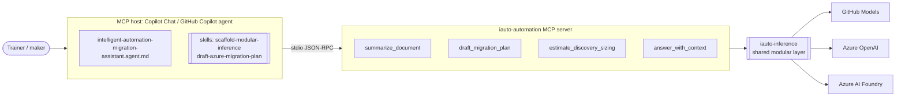

# Lab 5 — MCP capstone: a custom server, Copilot agent, and skills

> **Module B.1.1 — Platform delivery capability (capstone).** You will build and drive a custom
> **Model Context Protocol (MCP)** server that exposes intelligent-automation tools, wire it into
> a custom **GitHub Copilot agent**, and back it with reusable **skills** — every AI call running
> on **modular, provider-agnostic inference** (GitHub Models / Azure OpenAI / Azure AI Foundry by
> configuration only).

This capstone ties together the earlier labs: document summarization (Lab 3), discovery & sizing
(Lab 1), migration planning, and grounded RAG answering (Lab 4) — all behind one MCP surface that
Copilot can call on your behalf.

## Objectives

By the end of this lab you will be able to:

1. **Run** a custom Python MCP server (stdio transport, official `mcp` SDK) that exposes four
   provider-agnostic tools.
2. **Register** the server with an MCP host (VS Code Copilot Chat, GitHub Copilot, or any MCP
   client) and call its tools.
3. **Invoke** a custom Copilot agent (`*.agent.md`) that orchestrates the MCP tools and the repo
   skills as an "intelligent automation migration assistant".
4. **Reuse** two skills (`scaffold-modular-inference`, `draft-azure-migration-plan`) that encode
   the program's golden patterns.
5. **Explain** how modular inference keeps every capability portable across GitHub Models, Azure
   OpenAI, and Azure AI Foundry — switched by configuration, never by code.

## Module B mapping

| Specialization requirement | How this lab delivers it |
| --- | --- |
| **B.1.1 Platform delivery capability** | A buildable capstone: an MCP server + Copilot agent + skills that deliver migration-assessment capability on Azure-first reference patterns. |
| Modular inference (course-wide rule) | All four tools reuse the shared `iauto-inference` layer; provider is chosen by `INFERENCE_PROVIDER`. |
| Discovery & sizing (B.1.2, Lab 1) | The `estimate_discovery_sizing` tool reuses deterministic sizing math. |

> Other Module B requirements (B.2.x / B.3.1 / B.4.x) are covered as **evidence-awareness**
> callouts across the course, not as buildable labs.

## Architecture



The four exposed tools:

| Tool | What it does | Reuses inference? |
| --- | --- | --- |
| `summarize_document` | Summarize a source doc for a stated audience and word budget. | Yes |
| `draft_migration_plan` | Draft a structured Power Platform → Azure migration plan. | Yes |
| `estimate_discovery_sizing` | Deterministic estate sizing/effort **plus** an optional AI narrative. | Optional (`include_narrative`) |
| `answer_with_context` | Answer **strictly** from supplied passages, else say "I don't know". | Yes |

## Prerequisites

- **Python 3.12** and **[uv](https://docs.astral.sh/uv/)** (`uv --version`).
- This repository cloned, on a branch that contains `src/mcp-server/` and `src/inference/python/`.
- An **MCP host**. Any of:
  - **VS Code** with **GitHub Copilot** (Agent mode) — uses `.vscode/mcp.json`.
  - **GitHub Copilot** with custom agents — uses the agent's own `mcp-servers` block.
  - The **MCP Inspector** (`uv run mcp dev …`) for manual tool calls.
- A **GitHub token with `models: read`** for the free default provider (GitHub Models). In
  Codespaces/Actions you can reuse the built-in token. (Azure providers are an optional upgrade —
  see [Paid-tier upgrade](#paid-tier-upgrade).)

> 🔐 **Never commit secrets.** Configuration lives in a git-ignored `.env`; only `.env.example`
> is committed. The VS Code example uses an input prompt so the token is never written to disk.

## Steps

### 1. Install and configure the server

```bash
cd src/mcp-server
uv venv --python 3.12
uv pip install -e ".[dev]"          # installs the server + the editable iauto-inference dep
cp .env.example .env                 # then set GITHUB_TOKEN (models: read)
```

`INFERENCE_PROVIDER` defaults to `github`. Leave it as-is for the free path.

### 2. Run the MCP server

```bash
uv run iauto-mcp-server              # serves over stdio (Ctrl-C to stop)
```

The process speaks JSON-RPC over **stdio**, so you will not see a prompt — that is expected. An
MCP host launches and talks to it for you. To poke it by hand, use the Inspector instead:

```bash
uv run mcp dev iauto_mcp/server.py   # opens the MCP Inspector UI; lists all four tools
```

> 💡 The stdio transport owns **stdout** for protocol traffic. This server keeps logs/telemetry on
> **stderr** so they never corrupt the JSON-RPC stream.

### 3. Register the server with your MCP host

**VS Code (Copilot Chat, Agent mode):** copy the example config to the repo root and reload.

```bash
# from the repo root
cp labs/lab-5-mcp-capstone/mcp.vscode.example.json .vscode/mcp.json
```

Open the **Chat: MCP** view, **Start** the `iauto-automation` server, and confirm four tools are
listed. (`.vscode/` is intentionally not committed by this lab — copy it locally.)

**GitHub Copilot custom agent:** no separate registration needed — the agent in step 4 already
declares the server in its `mcp-servers` block.

### 4. Invoke the custom agent

The agent lives at
[`.github/agents/intelligent-automation-migration-assistant.agent.md`](../../.github/agents/intelligent-automation-migration-assistant.agent.md).
It wires in the `iauto-automation` MCP server and references both skills.

Select it in your Copilot client (agent picker), then try prompts such as:

- *"Summarize this runbook for a migration lead in 80 words: …"* → `summarize_document`
- *"We have 40 Power Automate flows, 8 Power Apps, 12 Dataverse tables, 5 premium connectors,
  ~2,000,000 monthly runs. Size the Azure migration."* → `estimate_discovery_sizing`
- *"Draft a Power Platform → Azure migration plan for an invoice-approval flow; constraint: keep
  it consumption-tier."* → `draft_migration_plan` (+ the `draft-azure-migration-plan` skill)
- *"Using only the text I paste, what is the data residency requirement?"* → `answer_with_context`

### 5. Exercise the skills directly

Ask the agent to *"scaffold a new provider-agnostic summarization capability in Python"* — it
should apply the **`scaffold-modular-inference`** skill (injectable client + fake-based test, no
hard-coded provider). Ask it to *"draft a migration plan"* and it should apply
**`draft-azure-migration-plan`** (the standard six-section structure).

### 6. Prove modular inference (the capstone point)

Run the same tool twice with different providers — code unchanged, **configuration only**:

```bash
# free default
INFERENCE_PROVIDER=github uv run iauto-mcp-server

# switch to Azure OpenAI (fill AZURE_OPENAI_* in .env first)
INFERENCE_PROVIDER=azure_openai uv run iauto-mcp-server
```

Each text-returning tool reports its `provider` and `model` in the structured result, so you can
show the provider changing while the tool contract stays identical.

## Validation

Run the server's quality gates from `src/mcp-server` — all should be green:

```bash
uv run pytest                                   # fakes only — no network, no provider
uv run ruff check .
uv run ruff format --check .
uv run mypy --strict iauto_mcp tests
uv run bandit -c pyproject.toml -r iauto_mcp
uv run pip-audit                                # zero known vulnerabilities
```

You have completed the lab when:

- [ ] `uv run iauto-mcp-server` starts and an MCP host lists **four** tools (each with an output schema).
- [ ] The custom agent calls at least three of the four tools end-to-end.
- [ ] Both skills trigger on their respective prompts.
- [ ] A single tool produces output under **two** different `INFERENCE_PROVIDER` values.
- [ ] All quality gates above are green.

## Paid-tier upgrade

The free path uses **GitHub Models** — perfect for the classroom. For production-grade or
higher-throughput delivery, switch provider by configuration (no code change):

| Upgrade | What changes | Why |
| --- | --- | --- |
| **Azure OpenAI** | `INFERENCE_PROVIDER=azure_openai` + `AZURE_OPENAI_ENDPOINT` / `AZURE_OPENAI_DEPLOYMENT` (leave `AZURE_OPENAI_API_KEY` blank to use **Entra ID**). | Enterprise SLA, data residency, private networking, quota. |
| **Azure AI Foundry** | `INFERENCE_PROVIDER=foundry` + `AZURE_AI_FOUNDRY_ENDPOINT` / `AZURE_AI_FOUNDRY_MODEL` (Entra by default). | Model catalog, evaluations, and agent tooling in Foundry. |
| **Telemetry → Azure Monitor** | Set `IAUTO_OTEL_ENABLED=1` and wire an OTLP exporter to Application Insights. | Production tracing of tool calls and latency. |
| **Remote MCP transport** | Host the server behind HTTP/SSE instead of stdio. | Share one server across a team instead of per-developer stdio. |

Prefer **Entra ID / managed identity** over keys for every Azure provider; keys are a
class-delivery fallback only.

> 📋 **Evidence awareness:** a specialization assessor would capture, for B.1.1, the working MCP
> server and agent (a screenshot or transcript of Copilot calling each tool), the **provider-switch
> proof** (the same tool returning a different `provider`/`model` under two configurations), and
> the green quality-gate logs (tests, lint, type-check, security scan, dependency audit). Produce
> those artifacts as a by-product of the steps above — **do not build evidence-collection tooling.**

## Trainer notes

**Timing (~60–75 min):** setup & run server 15 · register with host 10 · agent + tools demo 20 ·
skills 10 · provider-switch + gates 15.

**Talking points**
- MCP is the *integration contract*; modular inference is the *portability contract*. The capstone
  shows both: Copilot doesn't know or care which model backs a tool.
- The server is a **thin transport layer** (`server.py`) over **injectable logic** (`tools.py`).
  That separation is exactly what makes the tests fast and provider-free — call it out.
- `estimate_discovery_sizing` is deliberately **deterministic** for the math and only uses
  inference for an *optional* narrative. Sizing/cost numbers are planning aids, not quotes.

**Common pitfalls**
- *"The server prints nothing."* Correct — stdio is for JSON-RPC. Use the Inspector to see tools,
  or check the host's MCP log. Any `print()` to **stdout** would break the protocol.
- *Token errors on GitHub Models.* The token needs `models: read`. Re-issue and update `.env`.
- *VS Code can't find the server.* Confirm `uv` is on PATH and `--directory src/mcp-server` is
  correct relative to the repo root; reload the window after editing `.vscode/mcp.json`.
- *Foundry/Azure "no model configured".* Set the provider's `*_MODEL` / `*_DEPLOYMENT` var — each
  provider needs its own model id.

**Reset steps**
- Stop the server (Ctrl-C) or stop it from the host's MCP view.
- `git checkout -- .vscode/mcp.json` or delete the local copy (it is not committed).
- Re-create the venv if dependencies drift: `rm -rf .venv && uv venv --python 3.12 && uv pip install -e ".[dev]"`.

**Solutions** live on the `solutions` branch.
