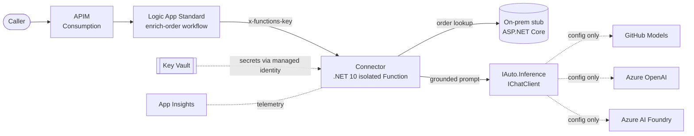

# Lab 6 — Hybrid integration + ALM / CI-CD + security

> **Module B:** B.1.1 (platform delivery capability) · B.3.2 (ALM for Power Platform / Azure)
> **Duration:** ~45 min · **Cost:** free / consumption tiers (paid upgrades noted)

Power Platform solutions routinely reach back into **on-prem** line-of-business systems
through an on-premises data gateway, and they ship through **managed ALM** (solutions,
environments, pipelines). This lab migrates both ideas to Azure: a **hybrid integration**
front door (**APIM → Logic Apps Standard → a .NET connector → an on-prem system**) and the
**ALM story** that delivers it — **Bicep** Infrastructure as Code promoted across
**dev → test → prod** by **GitHub Actions** with **OIDC**, **environment approval gates**,
and **CodeQL** scanning. The connector enriches responses through the course's **modular
inference** layer, so the AI runs on GitHub Models, Azure OpenAI, or Azure AI Foundry by
configuration alone.

## Objectives

By the end of this lab you can:

1. Explain the hybrid reference architecture and where the **security boundary** sits
   (the on-prem system is never exposed directly).
2. Build and test the **connector + on-prem stub** locally — with the AI path fully faked,
   so no model or cloud is required.
3. Switch the **inference provider by configuration only** and see the contract hold.
4. Read the **Bicep** IaC (managed identity, Key Vault, App Insights, Function, Logic App,
   APIM) and validate it locally.
5. Stand up the **ALM pipeline**: CI (lint → build → test → vuln), CD (`what-if` → deploy
   with approval gates), and CodeQL — and explain how **OIDC** removes stored credentials.

## Module B mapping

| Requirement | How this lab delivers it |
| --- | --- |
| **B.1.1 — Platform delivery capability** | A deployable Azure reference architecture (APIM + Logic Apps Standard + Functions + on-prem broker) with managed identity, Key Vault, and App Insights. |
| **B.3.2 — ALM for Power Platform / Azure** | Bicep IaC parameterised per environment, delivered by GitHub Actions across dev/test/prod with OIDC, approval gates, `what-if` previews, and CodeQL. |

## Architecture



The caller never talks to the on-prem system or the model directly — APIM and the Logic App
broker every request, and secrets flow from Key Vault through a **user-assigned managed
identity**.

## Prerequisites

- The course **dev container** (recommended) — Python 3.12, **.NET 10**, `uv`, Azure CLI,
  GitHub CLI, `func`, and Bicep, ready to go. Otherwise see
  [`docs/prerequisites.md`](../../docs/prerequisites.md).
- Completed **Lab 0** (modular-inference smoke test) so `GITHUB_TOKEN` works with GitHub
  Models. The AI path here is **faked in tests**, so a token is only needed to run the live
  enrichment in step 3.
- For the optional Azure deploy (step 6): an **Azure subscription** and rights to create a
  resource group, plus a **federated (OIDC) app registration** — your facilitator will
  supply these or point at a shared sandbox.

All commands run from the repo root unless noted.

## Steps

### 1. Build and test the application tier

```bash
cd src/hybrid-integration
dotnet test HybridIntegration.slnx -c Release
```

You should see **29 passing tests** across the connector, on-prem stub, and their
integration. Everything is provider-free — the model and HTTP calls are replaced by fakes —
so this is fast and offline. Skim the layout in
[`src/hybrid-integration/README.md`](../../src/hybrid-integration/README.md).

> The connector's AI call is a single line — `_chatClient.CompleteTextAsync(prompt,
> systemPrompt, ct)` — against the **shared** `IAuto.Inference` `IChatClient`. There is no
> provider SDK anywhere in the feature code.

### 2. Run the hybrid flow locally

In one terminal, start the on-prem stub:

```bash
dotnet run --project src/hybrid-integration/OnPremStub      # http://localhost:5179
```

Confirm it is serving seeded data:

```bash
curl http://localhost:5179/orders            # ORD-1001, ORD-1002, ORD-1003
curl http://localhost:5179/orders/ORD-1001
```

In a second terminal, configure and start the connector:

```bash
cd src/hybrid-integration/Connector
cp local.settings.json.example local.settings.json   # edit GITHUB_TOKEN
func start                                            # http://localhost:7071
```

Ask an order-status question through the connector:

```bash
curl -s http://localhost:7071/api/enrich-order \
  -H 'Content-Type: application/json' \
  -d '{ "orderId": "ORD-1001", "question": "Where is my order and when will it arrive?" }'
```

The response contains the on-prem `status` **and** a grounded natural-language `answer`,
plus the `provider` and `model` that produced it.

> The Logic App workflow (`logic-app/enrich-order/workflow.json`) wraps this same call with
> a Request trigger, a Response, and an upstream-failure branch. Running it locally needs the
> Logic Apps extension for Core Tools — see [`logic-app/README.md`](../../src/hybrid-integration/logic-app/README.md).
> It is **not** required to complete this lab.

### 3. Switch the inference provider (configuration only)

Stop the connector. In `local.settings.json`, change **only** configuration:

```jsonc
"INFERENCE_PROVIDER": "azure_openai",
"AZURE_OPENAI_ENDPOINT": "https://<resource>.openai.azure.com/",
"AZURE_OPENAI_DEPLOYMENT": "gpt-4o-mini"
// API key optional → omit to use Entra ID (DefaultAzureCredential)
```

Restart and re-run the `curl` from step 2. The same request/response contract holds — only
`provider`/`model` change. **No code was edited.** This is the Power Platform → Azure
migration lever: start free on GitHub Models, graduate to Azure OpenAI or Foundry without
touching the integration.

### 4. Read and validate the Bicep IaC

The infrastructure lives in
[`infra/bicep/integration`](../../infra/bicep/integration). Validate the whole module graph
and the parameter files locally — no Azure sign-in required:

```bash
cd infra/bicep/integration
az bicep install
az bicep build --file main.bicep
for e in dev test prod; do az bicep build-params --file params/$e.bicepparam; done
```

Open `workload.bicep` and trace the wiring: one **user-assigned managed identity** is granted
**Key Vault Secrets User** and the storage data roles; the Function uses
`@Microsoft.KeyVault(...)` references resolved through `keyVaultReferenceIdentity`; the Logic
App reaches the Function with a host key. Note the per-environment knobs in `params/*` —
purge protection is **off** in dev/test and **on** in prod.

### 5. Wire the ALM pipeline

Three workflows live in [`.github/workflows`](../../.github/workflows):

| Workflow | Purpose |
| --- | --- |
| `ci.yml` | Discovers every solution and Python project; runs **build → test → format → vulnerability scan** (.NET) and **ruff + pytest** (Python), with format/type/security as telemetry. |
| `cd-infra.yml` | **Validate** Bicep on PRs; on push/dispatch, `what-if` → deploy promoted **dev → test → prod** with **OIDC** login and **environment approval gates**. |
| `codeql.yml` | **CodeQL** static analysis for **C# + Python** (build-mode `none`) for code-scanning telemetry. |

To enable the CD pipeline in your fork:

1. Create a **federated credential** on an Entra app registration for this repo
   (subject e.g. `repo:<owner>/<repo>:environment:dev`). No client secret is created — that
   is the point of OIDC.
2. Add repository (or environment) **secrets**: `AZURE_CLIENT_ID`, `AZURE_TENANT_ID`,
   `AZURE_SUBSCRIPTION_ID`, plus `INFERENCE_TOKEN` (your GitHub Models / provider token) and
   `ONPREM_API_KEY`.
3. Create GitHub **Environments** `dev`, `test`, `prod`; add **required reviewers** to
   `test` and `prod` so promotion pauses for approval.

Open a small PR that touches `infra/bicep/integration/**` and watch **CI** and the **CD
validate** job run with no cloud credentials. Merging (or dispatching `cd-infra`) starts the
gated promotion.

### 6. (Optional) Deploy to Azure dev

With the secrets above configured, run a preview then a deploy:

```bash
az deployment sub create \
  --name lab6-dev-preview --location westeurope \
  --template-file infra/bicep/integration/main.bicep \
  --parameters infra/bicep/integration/params/dev.bicepparam \
  --parameters gitHubToken="$INFERENCE_TOKEN" onPremApiKey="$ONPREM_API_KEY" \
  --what-if
```

Re-run without `--what-if` to deploy (or just dispatch the `cd-infra` workflow). Tear down
afterwards with `az group delete --name rg-iauto-dev --yes --no-wait`.

## Validation

You have completed the lab when:

- [ ] `dotnet test HybridIntegration.slnx` shows **29 passing tests**.
- [ ] `curl .../api/enrich-order` returns an order `status` **and** a grounded `answer`.
- [ ] Changing `INFERENCE_PROVIDER` alone changes `provider`/`model` with no code edit.
- [ ] `az bicep build --file main.bicep` and all three `build-params` succeed.
- [ ] On a PR, **CI** is green and **CD validate** runs without Azure credentials.
- [ ] You can explain how OIDC + environment gates replace stored credentials and add approvals.

## Paid-tier upgrade notes

| Lab default (free / consumption) | Production upgrade |
| --- | --- |
| **APIM Consumption** | APIM **Developer** → **Standard v2** for VNet integration, SLA, higher throughput. |
| **Logic App WS1** plan | **WS2 / WS3** or a scaled App Service plan for sustained load. |
| **Functions Flex Consumption** | Raise `functionMaxInstanceCount`, or move to **Elastic Premium (EP)** for VNet + no cold start. |
| **Key Vault purge protection off** (dev/test) | **On everywhere**; add private endpoints. |
| **GitHub Models** inference | **Azure OpenAI** / **Azure AI Foundry** — flip `inferenceProvider` + settings; key via Key Vault. |
| On-prem **stub** | Replace with the real system reached over an **on-premises data gateway** / hybrid connection / private endpoint. |

> 📋 **Evidence awareness:** the specialization expects artifacts proving (a) a delivered
> platform capability and (b) disciplined ALM. An assessor would capture the deployed
> resource IDs, the APIM → Logic App → Function → on-prem call chain, the Key Vault RBAC
> assignment proving **managed-identity** (not key) access, a `what-if` diff, and a CD run
> showing the **dev → test → prod** promotion pausing at an **approval gate**, plus the
> CodeQL results. This lab *produces* those artifacts; per the course design we do **not**
> build evidence-collection tooling.

## Trainer notes

**Timing (~45 min).** Steps 1–2 (~12m) · step 3 provider swap (~6m) · step 4 Bicep read
(~9m) · step 5 ALM wiring (~12m) · validation + discussion (~6m). Step 6 is a stretch goal —
demo it from a pre-configured sandbox rather than waiting on live deploys.

**Talking points.**
- The **security boundary**: APIM and the Logic App are the only public surface; the on-prem
  system and the model are reached *through* the connector. Tie back to the Power Platform
  on-premises data gateway.
- **OIDC** is the headline ALM upgrade — federated, short-lived tokens, **no secrets stored**
  in GitHub. Contrast with long-lived service-principal secrets.
- **`what-if` before deploy** is the Azure analogue of solution-checker / managed-pipeline
  previews — show the diff before approving.

**Common pitfalls.**
- *Connector returns 400* — body must include both `orderId` and `question`.
- *Inference fails at startup* — the shared layer validates config eagerly; a missing
  `GITHUB_TOKEN` (or Azure endpoint/deployment) fails fast by design. Check
  `local.settings.json`.
- *CD job fails at login* — federated credential subject must match the triggering
  **environment** (`repo:<owner>/<repo>:environment:dev`). Mismatches are the #1 OIDC error.
- *`func` not found* — only needed to *run* locally (steps 2–3); the solution builds and
  tests without it.

**Reset between runs.** `dotnet clean HybridIntegration.slnx`; delete any local
`local.settings.json`; `az group delete --name rg-iauto-<env> --yes --no-wait`. Because
dev/test leave **purge protection off**, Key Vault names free up immediately for the next
cohort.

**Solutions.** A completed reference lives on the `solutions` branch.
