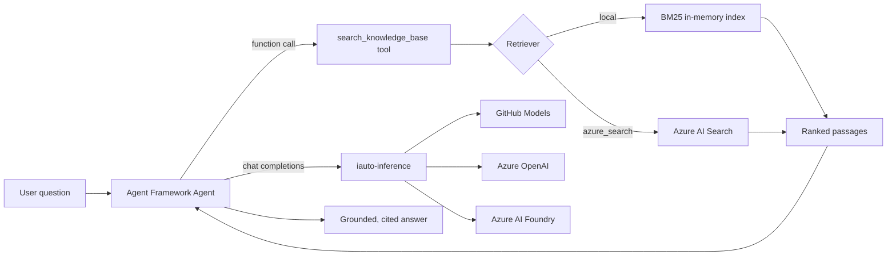

# iauto-foundry-agent

> **Lab 4 — Copilot Studio → Azure AI Foundry agent with RAG.**
> A grounded knowledge agent built on **Microsoft Agent Framework**, retrieving over a
> knowledge base, and running on the shared **modular inference** layer (GitHub Models /
> Azure OpenAI / Azure AI Foundry — by configuration only).

This package is the *migration target* for a Copilot Studio bot. A Copilot Studio bot couples
a system prompt, a knowledge source, and topic/tool triggers. Here the same shape is expressed
in portable Python:

| Copilot Studio concept | Here |
| --- | --- |
| Bot brain / GPT model | `agent_framework.Agent` over `iauto-inference` (3 providers, config-only) |
| Knowledge source | RAG `search_knowledge_base` **function tool** + pluggable retriever |
| Topic / tool trigger | Model-driven function calling (the agent decides when to retrieve) |
| Grounded, cited answers | System instructions that require tool use and `[n]` citations |

## Why a custom BM25 local index?

The default retriever is an in-memory **Okapi BM25** index — a strong, classic lexical ranker
implemented directly (no third-party, no paid search dependency). It lets the whole lab run
with **zero Azure**. Flip `RETRIEVER_BACKEND=azure_search` to move the *same code* onto Azure
AI Search (vector + semantic ranking) — a configuration change, not a rewrite.

## Install

```bash
# Python 3.12 via uv (https://docs.astral.sh/uv/)
uv venv --python 3.12
uv pip install -e ".[dev]"            # local lab — no Azure needed
uv pip install -e ".[azure,telemetry,dev]"   # + Azure AI Search & App Insights
```

The package depends on the sibling `iauto-inference` package via a path dependency
(`[tool.uv.sources]`), so install it from inside this folder.

## Configure

Copy `.env.example` to `.env` and set at least a provider. The free default only needs a
`GITHUB_TOKEN`:

```bash
cp .env.example .env
# INFERENCE_PROVIDER=github  +  GITHUB_TOKEN=<your token>
```

## Use it

### CLI

```bash
# Preview retrieval only — no model call, no provider needed:
iauto-foundry-agent --show-context "how do I connect to the VPN?"

# List the bundled knowledge base:
iauto-foundry-agent --list

# Ask a grounded question (needs a provider configured):
iauto-foundry-agent "What's the expense limit for meals while travelling?"
```

### Library

```python
import asyncio
from iauto_foundry_agent import GroundedKnowledgeAgent

async def main() -> None:
    agent = GroundedKnowledgeAgent.from_env()
    print(await agent.ask("How many PTO days do full-time employees get?"))

asyncio.run(main())
```

Inspect retrieval without a model call (handy for evidence / debugging):

```python
from iauto_foundry_agent import BM25LocalRetriever

retriever = BM25LocalRetriever.from_path()        # bundled sample KB
for hit in retriever.search("reset my password", top_k=3):
    print(f"{hit.score:.2f}  {hit.document.title}")
```

## Switch providers (config only)

| Provider | Set |
| --- | --- |
| GitHub Models (free) | `INFERENCE_PROVIDER=github`, `GITHUB_TOKEN`, `GITHUB_MODELS_MODEL` |
| Azure OpenAI | `INFERENCE_PROVIDER=azure_openai`, `AZURE_OPENAI_ENDPOINT`, `AZURE_OPENAI_DEPLOYMENT` (+ Entra ID or `AZURE_OPENAI_API_KEY`) |
| Azure AI Foundry | `INFERENCE_PROVIDER=foundry`, `AZURE_AI_FOUNDRY_ENDPOINT`, `AZURE_AI_FOUNDRY_MODEL` (+ Entra ID or key) |

## Architecture



## Quality gates

```bash
uv run ruff check .
uv run ruff format --check .
uv run mypy iauto_foundry_agent
uv run bandit -c pyproject.toml -r iauto_foundry_agent
uv run pytest
uv run pip-audit
```

All tests use fakes — **no network, no live provider, no Azure**.

## Telemetry

`configure_telemetry()` is a no-op unless `APPLICATIONINSIGHTS_CONNECTION_STRING` is set, in
which case OpenTelemetry traces (including model calls) flow to Application Insights. The
connection string is provisioned by `infra/bicep/foundry-search`.

---

Part of the **Intelligent Automation Train-the-Trainer** course. The full lab walkthrough —
objectives, Module B mapping, validation, paid-tier upgrade, evidence awareness, and trainer
notes — lives in [`labs/lab-4-foundry-agent`](../../labs/lab-4-foundry-agent/README.md).
